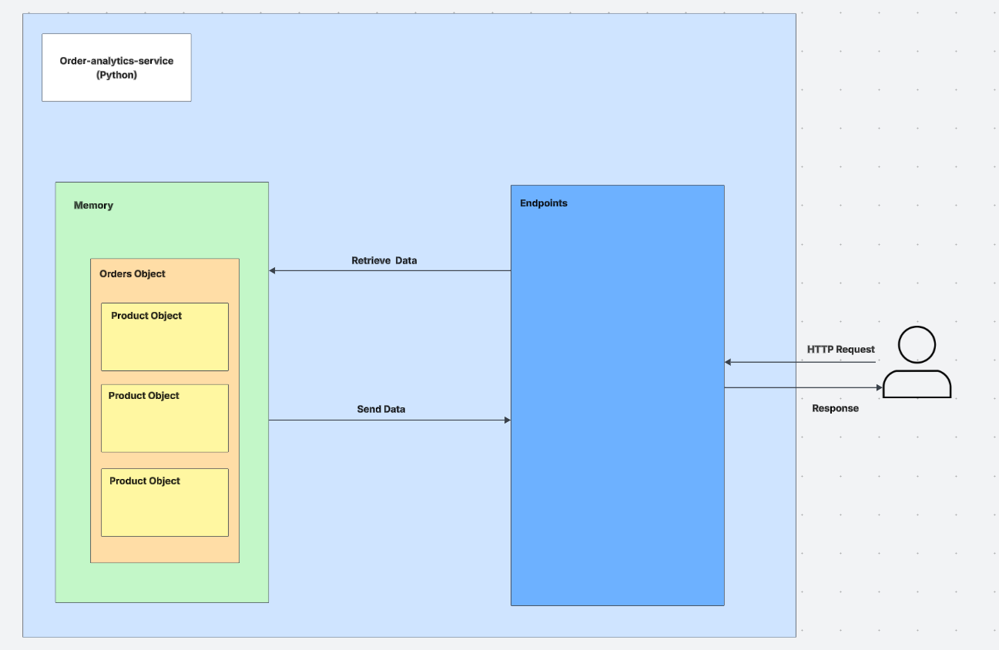
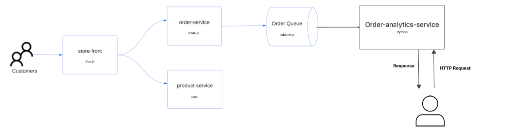

# CST8915-MidtermProject

## Demo Video

🎥 [Watch Demo Video]()

| Member | Role / Responsibility |
| :--- | :--- |
| Andy | Building Order Analytics Service, Overview of order analytics service, demoing order analytics service |
| Eric | A live demo of the application running locally — place orders, then show analytics endpoints |
| Connor | A live demo of the application running on Azure — show all deployed services, place orders, and verify analytics |

## Responsibility  
1. Build the Order Analytics Service
2. A brief overview of your order-analytics-service (language choice, architecture decisions)  
3. The RabbitMQ consumer pattern you chose and why
4. A live demo of the application running locally — place orders, then show analytics endpoints
5. A live demo of the application running on Azure — show all deployed services, place orders, and verify analytics
6. Creating and walkthrough of your architecture diagram

## Overview
The Order analytics service is written in Python and uses Flask for the endpoints of 
- `/analytics/summary`
- `/analytics/products` 
- `/analytics/top-products` 
- `/orders` 
- `/health`

The RabbitMQ consumer runs in the background thread with the Flask application. When orders are placed, the order service publishes it to RabbitMQ and the Order analytics service consumes it and updates the information about the products and orders. Through `GET` endpoints, the product or order information is available.  


## Architecture
The service follows a workers queue pattern. The order service publishes to an `order_queue` and the consumer (Order Analytics Service) consumes it with acknowledgements. This pattern was chosen because each order only needs to be processed once. The service runs as a single consumer as the data is stored in memory. Having multiple consumers would split orders and not report correct totals from the `GET` endpoints. To further scale this, the data consumed would need to be stored into a database to leverage multiple consumers.



## Source Code
[Python File](./app.py)

[Requirements File](./requirements.txt)

## Configuration (.env file)
```
RABBITMQ_HOST= <IP>
RABBITMQ_PORT= <PORT>
RABBITMQ_USER= <USERNAME>
RABBITMQ_PASS= <PASSWORD>
```

## Running Application
```bash
pip install -r requirements.txt

python app.py
```

## Resources
- https://www.rabbitmq.com/tutorials/tutorial-three-python


## Acknowledgements
- Used AI to help create the starter code for threads, pika, and flask 